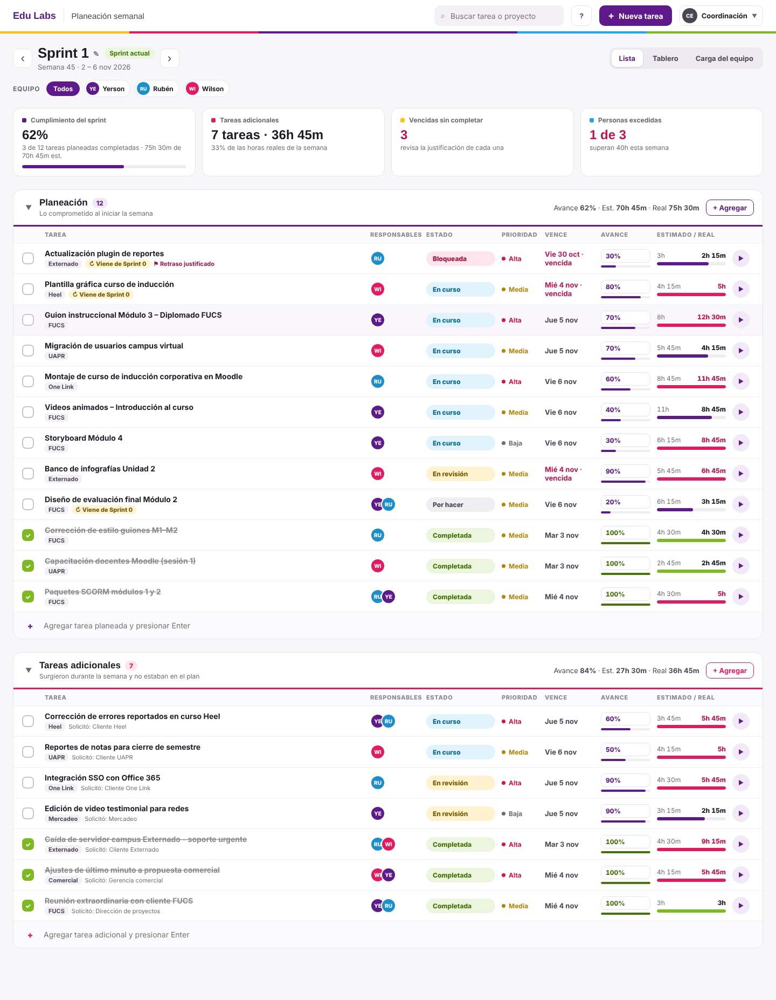

# Planeación semanal · Edu Labs

Aplicación web para que un equipo planee su semana, registre las **tareas adicionales** que surgen sin estar en el plan, mida el **tiempo real** frente al estimado y vea la **carga de cada persona** contra su capacidad. Construida a partir del prototipo «Gestión de tareas personalizada», conservando su identidad visual.



**Incluye:** inicio de sesión y roles (Coordinación / Colaborador) · semanas ISO con arrastre de pendientes · vistas Lista, Tablero (arrastrar y soltar) y Carga del equipo · panel de detalle con autoguardado · cronómetro por persona, sumas rápidas y corrección manual · justificación de retrasos · búsqueda y filtros · indicadores · «Deshacer» · administración de personas y ajustes · auditoría · diseño responsive.

---

## 1. Requisitos

- **Node.js 22.18 o superior** (LTS recomendado). Los instaladores lo instalan si falta.
- **Base de datos:**
  - **En su computador: SQLite**, que viene incluido en Node. No hay que instalar nada; el archivo `data/planeacion.db` se crea solo.
  - **En el servidor: PostgreSQL 16**, ya preparado. Ver [docs/DATABASE.md](docs/DATABASE.md) y [docs/DEPLOYMENT.md](docs/DEPLOYMENT.md).

El motor se elige con `DATABASE_URL` en `.env`: `sqlite:./data/planeacion.db` (por defecto) o `postgres://…`.

## 2. Instalación local (modo desarrollo)

Descomprima el proyecto, por ejemplo en `Escritorio/planeacion-semanal`, abra una terminal en esa carpeta y ejecute:

| Sistema | Comando |
|---|---|
| **Windows** (PowerShell) | `powershell -ExecutionPolicy Bypass -File .\instalar.ps1` |
| **macOS / Linux** | `bash instalar.sh` |

El instalador verifica o instala Node.js, instala las dependencias (`npm install`), crea `.env`, compila, prepara la base SQLite e inicia el modo desarrollo en **http://127.0.0.1:3000**.

O paso a paso, en cualquier sistema:

```bash
npm install          # dependencias (la primera vez genera package-lock.json)
npm run setup        # .env, compilación y base de datos SQLite
npm run dev          # http://127.0.0.1:3000 · se recarga al guardar cambios · Ctrl+C para detener
```

Para volver a empezar con datos limpios: detenga el servidor y ejecute `npm run db:reset`.

### Credenciales de prueba (solo datos de demostración)

| Rol | Correo | Contraseña |
|---|---|---|
| Coordinación | `coordinacion@edulabs.test` | `Coordinacion2026` |
| Colaborador | `yerson@edulabs.test` · `ruben@edulabs.test` · `wilson@edulabs.test` | `Equipo2026` |

Se definen en `.env` (`SEED_ADMIN_PASSWORD`, `SEED_MEMBER_PASSWORD`). **No use estos datos en producción.**

Los datos de demostración reproducen las semanas 44 y 45 del prototipo, desplazadas para que coincidan con la **semana anterior y la actual**. Para ver la demo exactamente con las fechas del prototipo, agregue `APP_TODAY=2026-11-05` al `.env` (solo desarrollo) y ejecute `npm run db:reset`.

## 3. Desarrollo

```bash
npm run dev                 # recompila la interfaz al guardar y reinicia el servidor (http://127.0.0.1:3000)
```

Con `SEED_ON_EMPTY=true` (por defecto en `.env.example`) la base de datos se siembra sola si está vacía. Alternativa en segundo plano (macOS/Linux/Git Bash): `npm run app:start` / `npm run app:stop`.

## 4. Comandos

| Comando | Descripción |
|---|---|
| `npm run setup` | Prepara el entorno local (`.env`, compilación, base de datos). `-- --browsers` instala Chromium para las pruebas |
| `npm run dev` | Modo desarrollo con recarga |
| `npm run build` | Build de producción (`dist/`) |
| `npm start` | Inicia el servidor compilado |
| `npm run app:start` / `app:stop` | Inicia / detiene en segundo plano |
| `npm run db:local` | Inicia un PostgreSQL 16 local desechable para ensayar (requiere binarios de PostgreSQL) |
| `npm run db:migrate` | Aplica migraciones pendientes (en producción, con el rol propietario) |
| `npm run db:schema` | Regenera `deploy/postgres/schema.sql` |
| `npm run db:seed` | Carga datos de demostración (base vacía) |
| `npm run db:reset` | **Borra** las tablas de la aplicación y vuelve a sembrar (bloqueado en producción) |
| `npm run db:backup [-- carpeta]` | Respaldo en `backups/` (SQLite: copia en caliente · PostgreSQL: `pg_dump`) |
| `npm run user:create-admin` | Crea un administrador (`ADMIN_EMAIL`, `ADMIN_NAME`, `ADMIN_PASSWORD`) |
| `npm run lint` | Análisis estático |
| `npm run typecheck` | Verificación de tipos |
| `npm test` | Pruebas unitarias |
| `npm run test:integration` | Pruebas de integración con SQLite (API + base aislada) |
| `npm run test:integration:pg` | Las mismas pruebas contra PostgreSQL + cliente PostgreSQL |
| `npm run test:coverage` / `test:coverage:pg` | Cobertura con umbrales (≥ 80 % global, ≥ 90 % lógica de negocio), con SQLite / PostgreSQL |
| `npm run test:e2e` | Pruebas E2E con Playwright (Chromium) |
| `npm run test:visual` | Pruebas visuales (4 resoluciones) |
| `npm run test:all` | Batería completa en orden (requiere bash; en Windows, Git Bash) |
| `npm run audit:deps` | Auditoría de dependencias (requiere red) |

Para las pruebas de navegador, la primera vez: `npx playwright install chromium` (o `npm run setup -- --browsers`). Usan SQLite; con PostgreSQL: `E2E_DB=postgres`.

## 5. Configuración

Todas las variables están documentadas en [`.env.example`](.env.example). Las más importantes: `PORT`, `DATABASE_URL` (PostgreSQL, ver [docs/DATABASE.md](docs/DATABASE.md)), `DB_POOL_MAX`, `DB_AUTO_MIGRATE`, `APP_TIMEZONE` (define «hoy»; por defecto `America/Bogota`), `SESSION_TTL_HOURS`, `TRUST_PROXY`, `COOKIE_SECURE`, `TIMER_MAX_HOURS`.

## 6. Docker

```bash
docker compose up --build                               # SQLite + datos de demostración → http://localhost:3000
docker compose -f docker-compose.postgres.yml up --build   # ensayo con PostgreSQL 16
docker compose down
```

Producción contra su servidor PostgreSQL, con HTTPS automático (Caddy) y respaldos diarios: ver [docs/DEPLOYMENT.md](docs/DEPLOYMENT.md).

## 7. Estructura

```
src/shared/   Dominio compartido: reglas, semanas, validación, tipos
src/server/   API (node:http), servicios, repositorios, migraciones, CLI
src/client/   Interfaz React (componentes, hooks, cliente API)
tests/        unit/ · integration/ · e2e/ (incluye visuales y capturas de referencia)
scripts/      build, dev, lint, cobertura, batería completa, inicio/detención
deploy/       Caddyfile y servicio systemd
docs/         Documentación, evidencias y reportes
```

## 8. Documentación

| Documento | Contenido |
|---|---|
| [PROTOTYPE_AUDIT](docs/PROTOTYPE_AUDIT.md) | Auditoría del prototipo original |
| [FUNCTIONAL_REQUIREMENTS](docs/FUNCTIONAL_REQUIREMENTS.md) | Requerimientos y permisos por rol |
| [ARCHITECTURE](docs/ARCHITECTURE.md) | Arquitectura, modelo de datos, API, seguridad |
| [DATABASE](docs/DATABASE.md) | PostgreSQL: conexión, roles, migraciones, modelo, respaldos |
| [TECHNICAL_DECISIONS](docs/TECHNICAL_DECISIONS.md) | Decisiones y justificaciones |
| [IMPLEMENTATION_PLAN](docs/IMPLEMENTATION_PLAN.md) | Plan, prioridades, riesgos y estado |
| [TESTING](docs/TESTING.md) | Estrategia de pruebas y cobertura |
| [DEPLOYMENT](docs/DEPLOYMENT.md) | Producción, respaldos, despliegue y rollback |
| [QA_REPORT](docs/QA_REPORT.md) | Resultados y defectos corregidos |
| [KNOWN_ISSUES](docs/KNOWN_ISSUES.md) | Limitaciones y pendientes |

## 9. Solución de problemas

| Síntoma | Causa probable | Solución |
|---|---|---|
| Error de sintaxis TypeScript al usar `npm run dev` o `db:*` | Node anterior a 22.18 | Actualice Node |
| «Defina DATABASE_URL» | Producción sin la variable | En producción es obligatoria (PostgreSQL) |
| PowerShell: «la ejecución de scripts está deshabilitada» | Política de ejecución | Use `powershell -ExecutionPolicy Bypass -File .\instalar.ps1` |
| Puerto 3000 ocupado | Otra aplicación lo usa | Cambie `PORT` en `.env` |
| «No se pudo conectar con PostgreSQL» / 503 | Servidor caído, firewall, `pg_hba.conf` | Verifique host/puerto y que `pg_hba.conf` permita la IP con `scram-sha-256` |
| `28P01 password authentication failed` | Usuario o clave | Revise la URL (codifique `@ : /` en la clave) |
| «El esquema no está al día» | `DB_AUTO_MIGRATE=false` sin migrar | `npm run db:migrate` con el rol propietario |
| `pg_dump: server version mismatch` | Cliente `pg_dump` < 16 | Instale `postgresql-client-16` |
| «La interfaz no está compilada» | Falta `dist/public` | `npm run build` |
| No puedo iniciar sesión tras varios intentos | Bloqueo temporal (5 fallos → 15 min) o límite de intentos | Espere 15 min o reinicie el servidor en desarrollo |
| La semana actual aparece vacía | El tablero de la semana aún no se creó | Ingrese como Coordinación y use «Crear tablero» |
| Los iconos/logo no cargan | Sin acceso a moodle.com / Google Fonts | Se usan el logo textual y las fuentes del sistema; ver KNOWN_ISSUES K-09 |
