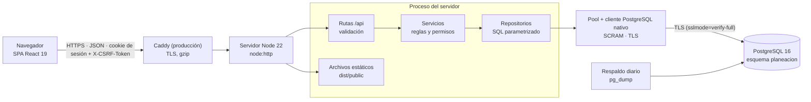
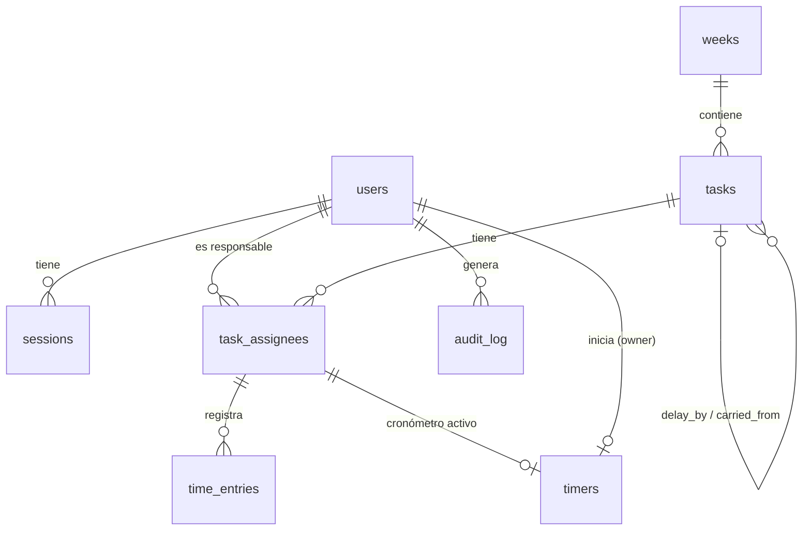

# Arquitectura

## 1. Visión general



Monolito modular: un solo proceso sirve la API y la interfaz compilada; los datos están en PostgreSQL 16 (detalle completo del modelo, tipos y roles en [DATABASE.md](DATABASE.md)). La lógica pura (reglas, semanas, validación) vive en `src/shared/` y la usan cliente y servidor.

## 2. Estructura del código

```
src/
  shared/            Dominio compartido (sin E/S)
    types.ts         DTO de la API
    constants.ts     Estados, prioridades, límites, paleta
    rules.ts         Reglas estado↔avance, arrastre, indicadores, carga
    weeks.ts         Semanas ISO, fechas y formatos
    validation.ts    Validador tipado + esquemas de la API
  server/
    index.ts         Arranque, apagado ordenado, limpieza de sesiones
    app.ts           Pipeline HTTP: cabeceras, CORS, rate limit, sesión, CSRF, JSON, errores, logs
    config.ts        Variables de entorno validadas
    logger.ts        Logs JSON con ocultamiento de secretos
    http/            router, errores HTTP, límites, archivos estáticos, utilidades
    routes/api.ts    Endpoints REST
    services/        auth, planner (semanas, tareas, tiempo, cronómetro), admin (personas, ajustes, auditoría)
    repositories/    Acceso a datos (users, sessions, tasks, timers, misc)
    db/              Conexión/transacciones (database.ts), migraciones, datos semilla
      pg/            Cliente PostgreSQL nativo: protocolo, SCRAM/MD5, TLS, pool, tipos
    cli/             migrate, seed, backup, create-admin
  client/
    main.tsx, App.tsx               Arranque y control de sesión
    hooks/usePlanner.ts             Estado de la pantalla y acciones (optimistas con reversión)
    lib/                            Cliente API, hooks utilitarios, modelo de presentación de tarea
    components/                     Header, WeekBar, StatsCards, ListView, BoardView, LoadView,
                                    TaskDrawer, EmptyWeek, AdminPanel, LoginPage, Overlays, ui
    styles.css                      Globales, animaciones y estados hover del prototipo
tests/  unit/ · integration/ · e2e/ (incluye visual.spec.ts y capturas de referencia)
scripts/ build, dev, lint, coverage, check-all, start/stop
deploy/  Caddyfile, servicio systemd
```

## 3. Modelo de datos



| Tabla | Claves e integridad |
|---|---|
| `users` | `id uuid`, `email` único y en minúsculas, `role ∈ {admin, member}`, color `#RRGGBB`, `active`, `in_team`, contador de fallos y bloqueo |
| `sessions` | `id` = SHA-256 del token, `csrf_token`, `expires_at` (índice), borrado en cascada con el usuario |
| `weeks` | `id` `AAAA-Wnn` (regex), `monday date` único y siempre lunes |
| `tasks` | `type`, `status`, `priority` con `CHECK`; `progress` 0–100; **`CHECK ((status='done') = (progress=100))`**; FK a semana, semana de origen/destino, tarea que justifica el retraso (`SET NULL`); `deleted_at` (borrado lógico) |
| `task_assignees` | PK (tarea, persona), `estimate_minutes ≥ 0`, persona `RESTRICT` (las personas se desactivan, no se borran) |
| `time_entries` | Libro de tiempo en segundos con origen (`timer`, `quick`, `manual`, `adjust`, `seed`); FK compuesta a la asignación |
| `timers` | Uno por usuario que lo inicia (PK `owner_id`) y uno por asignación (`UNIQUE(task_id,user_id)`) |
| `settings` | Clave/valor (`capacityHours`, `defaultView`) |
| `audit_log` | Usuario, acción, entidad, detalles JSON, IP, fecha |
| `schema_migrations` | Migraciones aplicadas |

## 4. API REST

Todas las respuestas son JSON. Errores: `{ "error": { "code", "message", "fields?" } }` con 400/401/403/404/405/409/413/415/422/429/500.

| Método | Ruta | Rol | Descripción |
|---|---|---|---|
| GET | `/api/health` | público | Estado del servicio y la base de datos |
| GET | `/api/auth/session` | público | `{ authenticated }` |
| POST | `/api/auth/login` | público | Inicia sesión (cookie + `csrfToken`) |
| POST | `/api/auth/logout` | sesión | Cierra la sesión |
| POST | `/api/auth/password` | sesión | Cambia la contraseña propia |
| GET | `/api/bootstrap` | sesión | Usuario, CSRF, hoy, semana actual, ajustes, equipo, semanas, cronómetro |
| GET | `/api/weeks/:weekId` | sesión | Tareas de la semana o pendientes de la anterior |
| POST | `/api/weeks` | admin | Crea tablero `{ weekId, carry }` |
| POST | `/api/weeks/:weekId/tasks` | sesión | Crea tarea |
| PATCH | `/api/tasks/:id` | sesión | Edita campos (aplica reglas estado↔avance) |
| DELETE | `/api/tasks/:id` | creador/admin | Borrado lógico |
| POST | `/api/tasks/:id/restore` | creador/admin | Restaura |
| PUT | `/api/tasks/:id/assignees/:userId` | sesión* | Agrega responsable / estimado / fija real (*real: propio o admin) |
| DELETE | `/api/tasks/:id/assignees/:userId` | sesión* | Quita responsable |
| POST | `/api/tasks/:id/time` | propio/admin | Suma minutos |
| GET | `/api/timer` | sesión | Cronómetro del usuario |
| POST | `/api/timer/start` · `/api/timer/stop` | propio/admin | Inicia (detiene el anterior) / detiene y registra |
| GET · PUT | `/api/settings` | sesión · admin | Ajustes |
| GET · POST | `/api/users` | sesión · admin | Equipo (admin ve todos) / alta |
| PATCH | `/api/users/:id` | admin | Rol, equipo, activo, contraseña |
| GET | `/api/audit?limit&offset` | admin | Auditoría paginada |

## 5. Flujo de una petición

1. `X-Request-Id`, cabeceras de seguridad.
2. `/api/*`: CORS (lista blanca), límite por IP, enrutado, autenticación por cookie, **verificación de `Origin` y token CSRF** en métodos que modifican, lectura de JSON (máx. 100 KB, `Content-Type` obligatorio).
3. Ruta → validación del esquema → servicio (permisos y reglas, transacción, auditoría) → repositorio.
4. Respuesta JSON `no-store`; errores controlados con código; errores inesperados → 500 genérico + log con `requestId`.
5. Resto de rutas: archivos de `dist/public` con protección de *path traversal* y *fallback* SPA.

## 6. Seguridad

| Riesgo | Medida |
|---|---|
| Inyección SQL | Solo consultas parametrizadas (protocolo extendido: los valores viajan separados del SQL); regla de lint `no-sql-concat`; prueba de integración con carga maliciosa |
| XSS | React escapa todo el contenido; prohibido `innerHTML`/`dangerouslySetInnerHTML` (lint); CSP `script-src 'self'`, `object-src 'none'`, `frame-ancestors 'none'` |
| CSRF | Token por sesión en cabecera + verificación de `Origin` + `SameSite=Lax` |
| Sesiones | Token aleatorio de 256 bits, guardado como hash; `HttpOnly`, `Secure` en producción; expiración deslizante; revocación al desactivar o cambiar contraseña |
| Contraseñas | scrypt con sal; política mínima (10 caracteres, letras y números); bloqueo tras 5 fallos; mensaje genérico; tiempo constante |
| Fuerza bruta / abuso | Límite de intentos de login por IP+correo y límite general por IP |
| Control de acceso | Comprobación de rol **antes** de validar la entrada en rutas de administración; permisos por recurso en servicios |
| Entradas | Validación de esquema estricta (campos desconocidos rechazados), límites de longitud, limpieza de caracteres de control, tamaño de cuerpo |
| Exposición de datos | Nunca se devuelven hashes; logs JSON con ocultamiento de claves sensibles; errores 500 sin detalles internos |
| Cabeceras | CSP, `X-Content-Type-Options`, `X-Frame-Options`, `Referrer-Policy`, `Permissions-Policy`, COOP/CORP, HSTS en producción |
| Dependencias | Servidor sin dependencias npm en ejecución (incluye su propio cliente PostgreSQL); interfaz: solo `react` y `react-dom` |
| Base de datos | TLS `verify-full`, SCRAM-SHA-256, rol de aplicación sin DDL, `statement_timeout`, esquema propio |
| Archivos subidos | No aplica: la aplicación no recibe archivos |

## 7. Escalabilidad y operación

- La aplicación no guarda estado en disco: puede ejecutarse en varias instancias contra el mismo PostgreSQL (sesiones y cronómetros están en la base; las migraciones usan un bloqueo consultivo). El limitador de solicitudes es por instancia (ver KNOWN_ISSUES).
- Salud: `GET /api/health` (usado por Docker `HEALTHCHECK` y Caddy).
- Respaldos: `pg_dump` (`npm run db:backup` o servicio `backup` en Compose). Detalle en [DATABASE.md](DATABASE.md).
- Apagado ordenado con `SIGTERM`/`SIGINT`.
